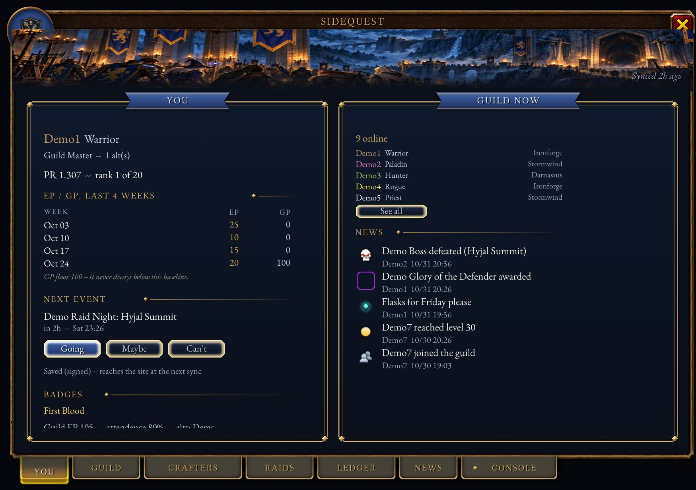
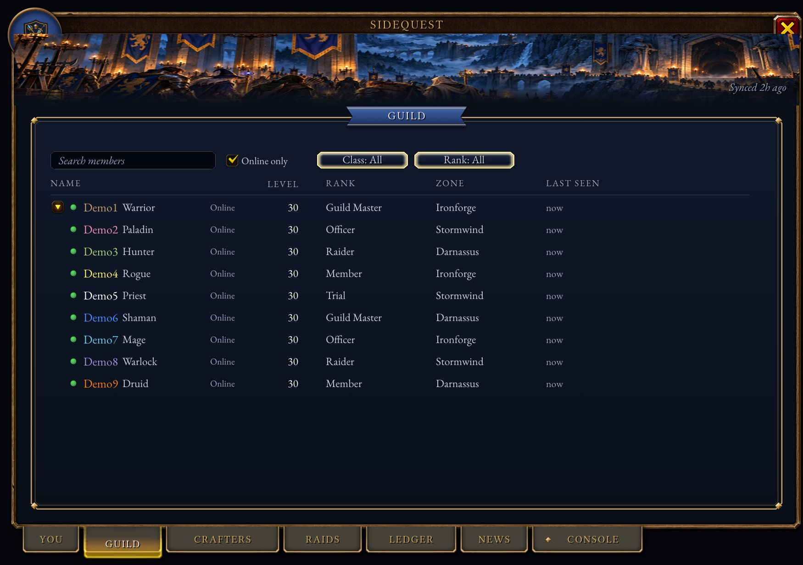
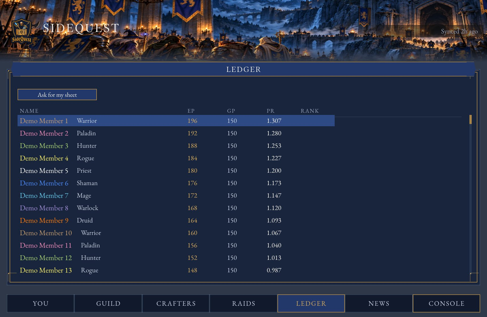
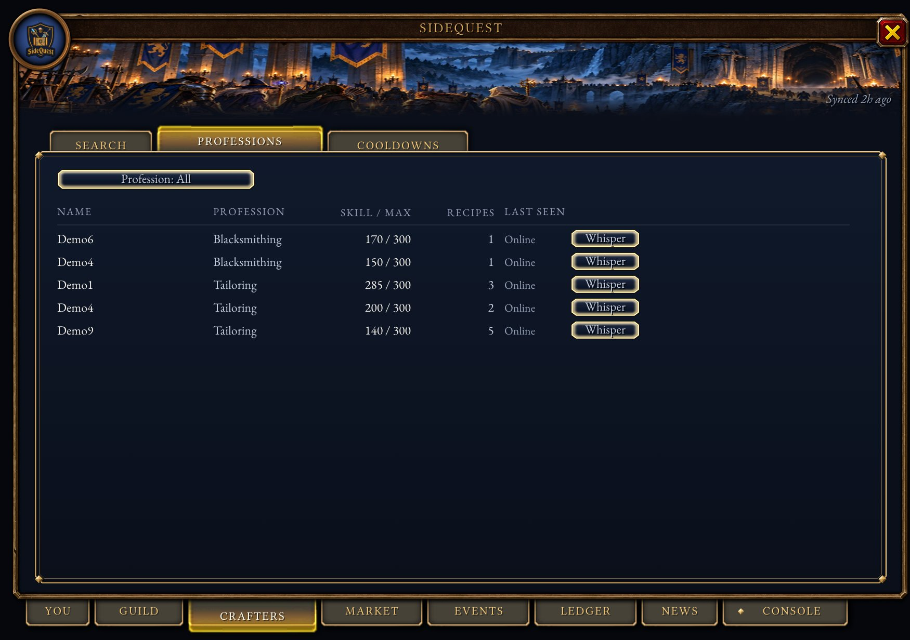
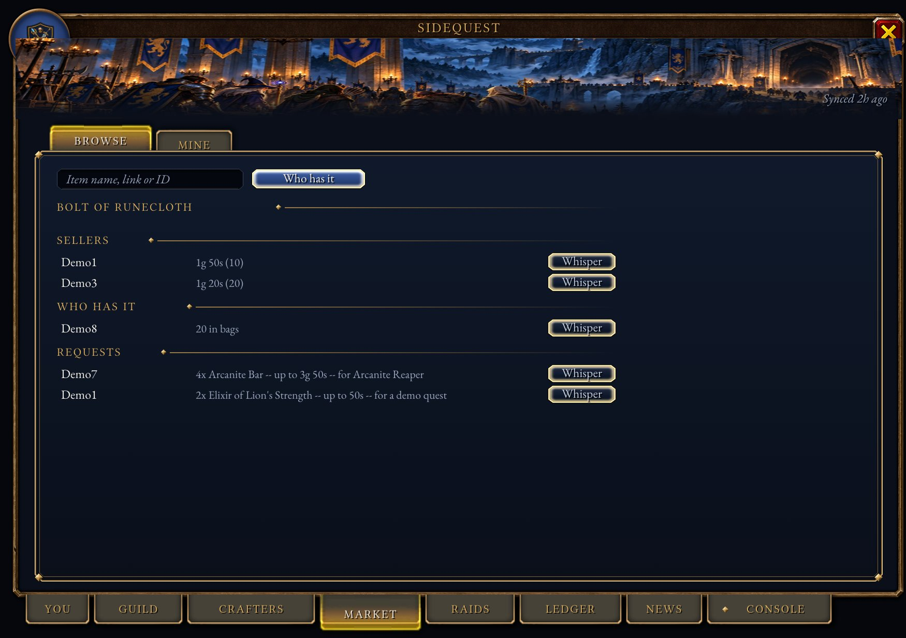
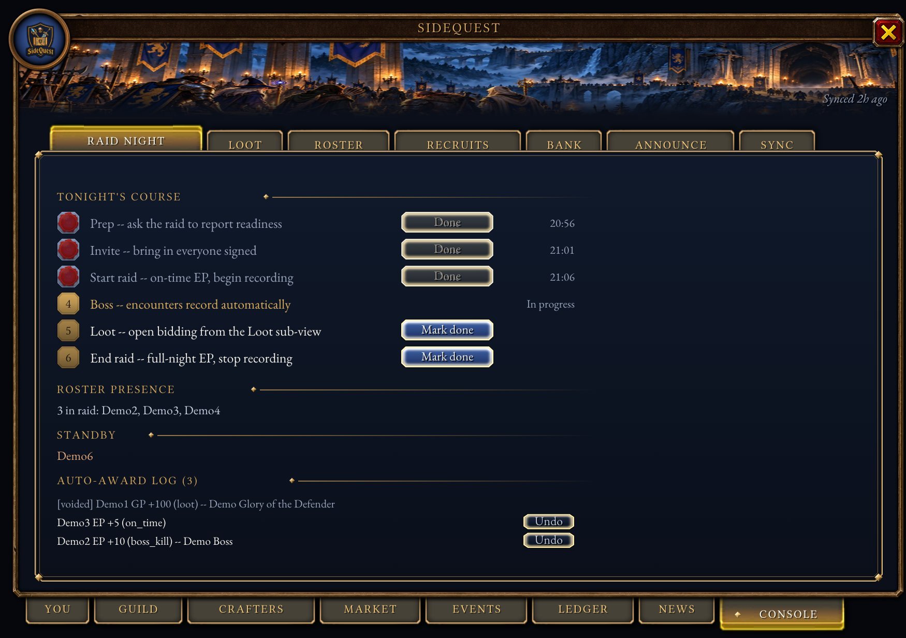
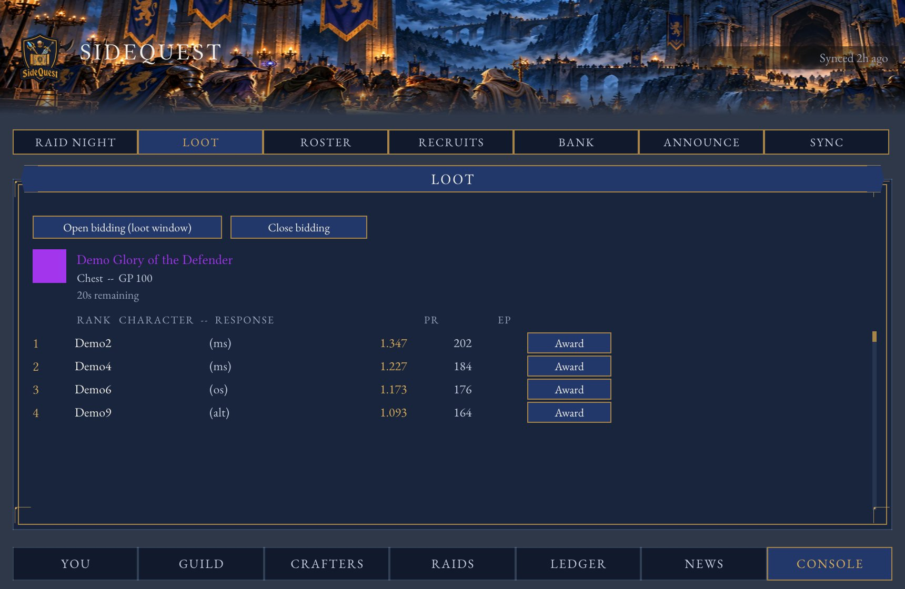

# SideQuest Guild

A World of Warcraft: Forever addon for the SideQuest guild. Members use it to see the roster, find crafters, sign up
for events and check their loot points. Officers use it to run raid nights, hand out loot and send the night's record
to [sidequest-guild.com](https://sidequest-guild.com).



These pictures are drawn outside the game from the addon's own code and art, with WoW: Forever's own window frame,
tabs and icons, and made-up guild members. Lighting and a few small details differ in game.

## Install

Install **SideQuest Guild** from [CurseForge](https://www.curseforge.com/projects/1773662) with the CurseForge app, or
download the zip from [GitHub releases](https://github.com/SideQuest-Guild/addon/releases) and unzip it into
`_forever_/Interface/AddOns/`. You should end up with `Interface/AddOns/SideQuest/SideQuest.toc`.

CurseForge and GitHub get the same zip, built by GitHub Actions and signed. [SECURITY.md](SECURITY.md) shows how to
check that a zip you downloaded came from this repo.

In game, click the crest on the minimap or type `/sq` to open the window. Drag the crest round the minimap to move it.

## Loot points

Raid loot goes by points. You earn EP (effort points) for raiding: 10 for each boss kill, 10 for the first night the
guild wipes on a boss it hasn't killed, 5 for being there at the start and 5 for staying to the end. Standby earns the
same. You spend GP (gear points) when you win an item, and everyone starts at 100 GP.

Your PR (priority) is your EP divided by your GP. When several people want an item for their main spec, the highest PR
wins it. Both EP and GP shrink by 15% each week, so recent raids count for more than old ones.

The full rules and prices are on the [Ledger page](https://sidequest-guild.com/ledger/).

## For members

 

| Tab | What it shows |
|---|---|
| You | Your PR and where it ranks, your last four weeks of points, your next event with Going, Maybe and Can't buttons, and who's online. |
| Guild | The roster, with alts under their main. Search it, filter by class, rank or online, and whisper or invite from it. |
| Crafters | Search a recipe or profession to see who can make it, online people first; every member with a profession and their skill; and who has Transmute, Mooncloth and other craft cooldowns ready. |
| Market | What guildmates sell and want to buy, open requests for materials, and who holds an item. Mine lists and edits your own. |
| Events | Upcoming events, how many have signed up for each role, and your own answer. |
| Ledger | Everyone's EP, GP and PR, then your own points history and loot. |
| News | Guild announcements and recent activity. |

Click someone on the Guild tab to see their level, spec, item level, professions, Onyxia attunement, tracked
reputations and cooldowns. Hover any item to see which guildmates craft, sell, buy or hold it.

Your event sign-ups reach the website the next time an officer syncs. You don't need to do anything else.

If you can come to a raid but the group is full, type `/sq standby`. An officer approves it and you earn EP as if you
were there.

## What the addon shares

SideQuest keeps a record of your character and shares it with the guild automatically: your professions and skill,
your level, class, spec and item level, your craft cooldowns, your Onyxia attunement and the few reputations the guild
tracks, what you sell and want to buy, and the crafting materials in your bags and bank (never gold or gear). That's
how the Crafters and Market tabs work for guildmates who are offline, and officers' syncs carry it to the website,
where only signed-in guild members see it.

Turn any part off on the You tab, or with `/sq share <prof|char|cd|market|stock> on|off`. `/sq dir` shows what you
share and how many guildmates the addon has heard from. Open each profession window once so the guild knows your
recipes; skill levels update by themselves.

 

### Selling, buying and asking for materials

Use the Market tab's Mine view, or these commands. An item can be a shift-clicked link, an item ID, or a name in
quotes.

| Command | What it does |
|---|---|
| `/sq sell <item> <price> [qty] [crafted]` | List something you sell, for example `/sq sell "Bolt of Runecloth" 1g20s 20`. |
| `/sq buy <item> <price>` | Put up a standing offer to buy a material. |
| `/sq request <item> <qty> [price] [note]` | Ask the guild for materials you need. |
| `/sq unrequest <item>` | Take a request down. |

Prices are gold, silver and copper (`1g20s`, `35s`, `80c`) or a plain number of gold (`1.5`). Leave the price off and
buyers whisper you instead. With Auctionator or TradeSkillMaster installed, the Mine view suggests a price.

## For officers

 

Officers get a gold **Console** tab. The addon treats you as an officer if your guild rank can edit officer notes. If
your officer ranks can't, pick the lowest rank that should count (the Guild Master is 0, the rank below is 1, and so on)
and run this once:

```
/run SideQuestDB.settings.officerRankIndex = 1
```

### Running a raid night

Follow the steps on the Console's **Raid Night** tab:

1. **Prep** asks the raid to report food, flasks and repairs.
2. **Invite** invites everyone who signed up on the website.
3. **Start raid** begins recording and gives everyone present 5 EP for being on time. The addon tells the raid you are
   recording, so a second officer doesn't record the same night.
4. Boss kills and wipes are recorded on their own. A kill gives 10 EP. The first wipe of the night on a boss the guild
   hasn't killed gives 10 EP, once per boss per night.
5. **Loot** opens bidding on each item in the loot window. Raiders get a popup with the item, its GP price, their PR and
   Main, Off and Pass buttons. The Loot tab lists the answers in the order the rules give: main spec by PR, then off
   spec, alts and disenchant. Chase items, legendaries and crafted tier are left for the loot council to decide.
6. **End raid** gives 5 EP to everyone still there and stops recording.

Every award prints a chat line with an undo command, and the Raid Night tab has an **Undo** button next to each one.

The other Console tabs:

| Tab | What it does |
|---|---|
| Loot | Bidding and awards, as above. If you aren't master looter, `/sq bid <item link>` opens bidding on any item. |
| Roster | Reads the guild roster for the website and lists inactive members. |
| Recruits | Applicants and trials, with yes/no votes from officers. |
| Bank | Saves the open guild bank tab's log for the website. |
| Announce | Posts a message to guild chat and every member's News tab, and to Discord if you tick the box. |
| Sync | Shows what hasn't been sent to the website yet, with Export and Import buttons. |

### Commands

| Command | Who | What it does |
|---|---|---|
| `/sq` | everyone | Opens or closes the window. |
| `/sq standby` | everyone | Asks to be on standby tonight. Officers in the raid add themselves. |
| `/sq help` | everyone | Lists every command. |
| `/sq minimap` | everyone | Hides or shows the minimap button. |
| `/sq scale <0.75-2>` | everyone | Makes the window bigger or smaller (1.25 by default); `/sq scale reset` goes back. |
| `/sq export` | officers | Makes the text to paste into the website. |
| `/sq export clear` | officers | Clears what was sent, once the website has accepted it. |
| `/sq import` | officers | Loads points and events from the website. |
| `/sq roster` | officers | Reads the guild roster now. |
| `/sq share <prof\|char\|cd\|market\|stock> on\|off` | everyone | Turns a part of your shared directory record on or off. |
| `/sq dir` | everyone | Shows directory sharing status and how many characters are known. |
| `/sq bid <item link>` | officers | Opens bidding on an item that isn't in the loot window. |
| `/sq undo <id>` | officers | Cancels a points award or loot record. |

## Sending a raid night to the website

After the raid, the record has to reach the website. Pick whichever is easiest:

1. Run [SideQuest Companion](https://github.com/SideQuest-Guild/companion/releases), a tray app for Windows, macOS
   and Linux. It watches the save file and uploads a new export the moment WoW writes it, so there's nothing to copy
   or paste. While WoW is closed it also checks the website for a new import and leaves it ready for an officer, so
   the next login picks up the new points on its own.
2. Type `/sq export`, copy the text and paste it on the [sync page](https://sidequest-guild.com/officers/sync/).
3. Upload the addon's save file on the same page. It is at
   `_forever_/WTF/Account/<your account>/SavedVariables/SideQuest.lua`, and WoW writes it when you log out or type
   `/reload`.
4. Let `sidequest-sync` upload it for you, as below.

When the website confirms the import, type `/sq export clear` so the next night starts empty. SideQuest Companion
stages the new import on its own, so an officer running it just needs to log in; everyone else clicks **Import** on
the sync page's text and pastes it with `/sq import`. Once one officer imports, the addon shares the new points with
every member online.

### sidequest-sync

`sidequest-sync` is a small program that finds the save file and uploads it whenever it changes. It needs
[uv](https://docs.astral.sh/uv/). Get a sync token from the [sync page](https://sidequest-guild.com/officers/sync/)
first; the site shows it only once.

```sh
uvx --from "git+https://github.com/SideQuest-Guild/addon#subdirectory=uploader" sidequest-sync login
uvx --from "git+https://github.com/SideQuest-Guild/addon#subdirectory=uploader" sidequest-sync watch
```

When the website confirms the import, type `/sq export clear` so the next night starts empty. Then click **Copy game
import string** on the sync page and paste it into `/sq import` in game. Once one officer imports, the addon shares the
new points with every member online.

## Not yet tested on Forever

Nobody has run the addon on a live Forever server yet. These parts may not work there, and the addon tells you when one
fails:

- Addon messages inside a raid. If the bidding popup can't reach raiders, award loot by hand from the Loot tab and read
  points out in voice chat.
- Master loot, which arrives with the raids on December 9. You can always record who got an item from the Loot tab.
- The guild bank log and recipe lists. If the game doesn't offer them, the Bank and Crafters tabs say so.
- The save file was unreliable during the beta. Export a few times during a long night instead of only at the end.

## Development

The addon is in `SideQuest/`, `sidequest-sync` is in `uploader/`, and the tests are in `tests/`. The tests run outside
the game against a fake copy of the WoW functions the addon uses.

```sh
luajit tests/run_tests.lua           # addon tests
luacheck SideQuest tests             # lint
uv run --directory uploader pytest   # uploader tests
```

The tests also write `tests/fixtures/export_v1.txt`, `export_v2.txt` and `export_v2_directory.txt`, sample raid and
directory records that the website's tests import. Copy them to the website repo when they change.

`tests/preview/` draws every tab and popup as an image so you can check the layout without the game. See
[tests/preview/README.md](tests/preview/README.md).

### Releasing

Commit subjects follow [Conventional Commits](https://www.conventionalcommits.org/). [git-cliff](https://git-cliff.org/)
builds `CHANGELOG.md` from them; `feat`, `fix` and `perf` commits are listed and the rest are left out.

```sh
git cliff --tag v0.2.0 -o CHANGELOG.md
git commit -am "docs: changelog for v0.2.0"
git tag -s v0.2.0 -m "SideQuest v0.2.0"
git push origin main v0.2.0
```

Pushing the tag starts the release workflow. It writes that version's notes with git-cliff, builds the zip and uploads
it to CurseForge, signs build provenance and an SBOM for it, and publishes it as a GitHub release. A published
release's files can't be changed, and `v*` tags can't be moved or deleted, so a bad release is fixed with a new version.

To test the workflow without releasing, run it by hand from the Actions tab with the tag left blank. It builds and
signs the zip, uploads nothing to CurseForge, and leaves a draft release named `dry-run-<run id>` that you can delete.
Running it by hand with an existing tag, such as `v0.1.0`, publishes that tag as a GitHub release without uploading it
to CurseForge again.

`main` takes signed commits only, and force pushes and deleting it are blocked.

## License

MIT. See `LICENSE`.
